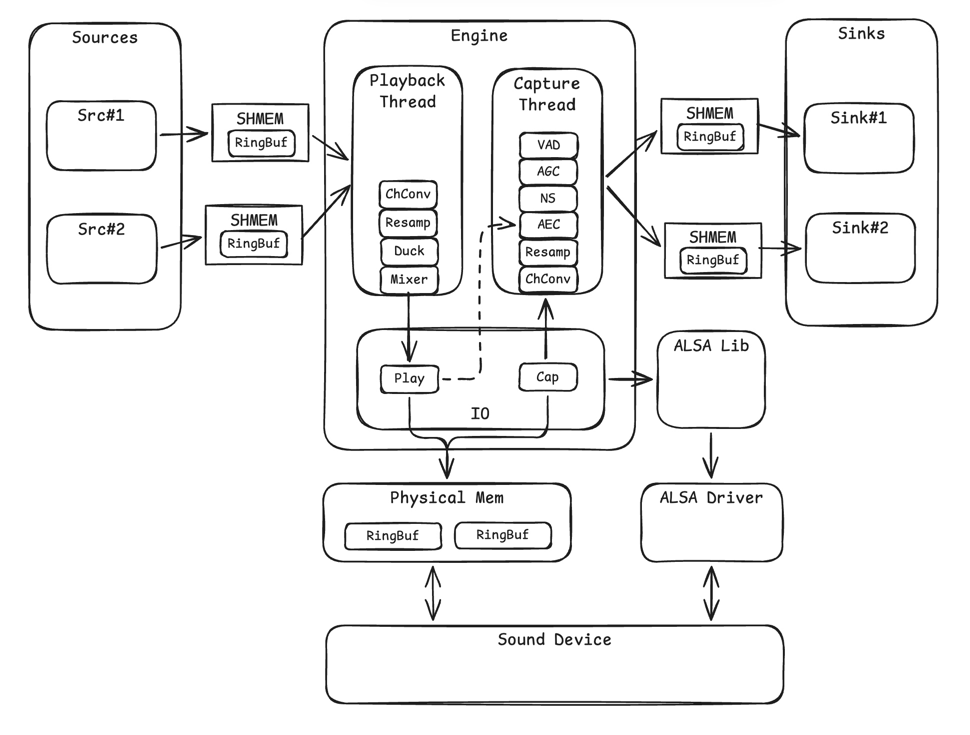

# ALSA Sound Engine Demo

A Linux demo that combines ALSA mmap full-duplex I/O, speexdsp DSP (AEC/NS/AGC/VAD), FFmpeg resampling, and multi-client mixing over POSIX shared memory.

## Architecture



Features:

- **I/O**
  - Full-duplex playback and capture using mmap.
  - Automatic ALSA device probing.
  - Hardware timestamps for playback/capture alignment.
- **Playback and Mixing**
  - Multiple playback channels and mixing.
  - Priority-based ducking and lookahead limiter.
  - Accept 16/32/44.1/48 kHz mono/stereo client streams.
  - Resampling provided by FFmpeg.
- **Capture and DSP**
  - Raw and processed capture channels.
  - AEC, NS, AGC, and VAD provided by speexdsp.
- **Controls and IPC**
  - UNIX-domain socket for control.
  - POSIX shared-memory ringbuffer for audio data.

## Prerequisites

The engine needs exclusive access to the sound card. If PipeWire is installed, stop it first:

```bash
systemctl --user stop pipewire pipewire-pulse wireplumber
```

Restore PipeWire when finished:

```bash
systemctl --user start pipewire pipewire-pulse wireplumber
```

Install the build dependencies:

```bash
sudo apt install -y build-essential libasound2-dev libspeexdsp-dev \
    libavutil-dev libswresample-dev
```

Build:

```bash
make
```

## Running

### 1. Start the engine

```bash
./alsa-engine
```

The engine tries to open a device in the following order:

- env `ALSA_ENGINE_DEVICE`
- `default`
- `plughw:0,0`
- `hw:0,0`

If engine started successfully, it will print the following status line every second:

```
[engine]    1s ur/or=0/0   play=100/s rec=100/s buf= 48/  2ms
```

- `ur`: playback underrun count
- `or`: capture overrun count
- `play/s`: playback blocks per second
- `rec/s`: capture blocks per second
- `buf`: playback/capture buffered milliseconds

Environment variables:

- `ALSA_ENGINE_DEVICE`: force the ALSA device name
- `BYPASS_DSP`: disable the whole DSP stage (capture reads raw PCM)
- `NO_AEC`: disable AEC only
- `NO_NS`: disable NS/AGC/VAD preprocessing

### 2. Start the interactive demo

```bash
./demo
```

The demo continuously plays `media.wav` and loads `nav.wav` and `alert.wav` from the `assets` directory next to the executable. Clips must be S16 LE WAV files in 16/32/44.1/48 kHz mono/stereo.

Keys:

- `n`: play a navigation prompt; media ducks
- `a`: play an alert prompt; media and nav duck
- `r`: start/stop recording from the DSP-processed microphone channel (up to 60 seconds)
- `p`: play the last recording through loopback; background media pauses during playback
- `c`: toggle AEC
- `+` / `-`: adjust hardware playback volume
- `q` or Ctrl-C: quit

## Internals

### Channel

The engine provides channels to embed semantic meaning into the audio streams.

Playback channels:

| Channel | Purpose | Ducking policy |
|---|---|---|
| `media` | Background music and normal media | 30% while `nav` is active; 10% while `alert` is active |
| `nav` | Navigation and ordinary voice prompts | 100%; reduced to 10% by `alert` |
| `alert` | Safety prompts and urgent events | Always 100% |
| `loopback` | Diagnostics and recorded-audio playback | Always 100%; outside application ducking |

Capture channels:

| Channel | Signal | Format |
|---|---|---|
| `mic` | Post-DSP capture (AEC/NS/AGC) | 16 kHz mono |
| `mic_raw` | Pre-DSP capture | Native capture rate/channels |

## Client lifecycle

- A client connects to the engine and sends a registration message.
- The engine allocates a shared-memory ring for the channel.
- The client keeps the socket open; disconnecting unregisters the channel.
- The engine reclaims the shared memory when the client disconnects.
- Audio data crosses the process boundary through these rings; the socket carries control messages only.

## Thread architecture

The engine has three long-running threads. ALSA devices are opened in the main
thread before either worker starts; after that, only the corresponding worker
reads or writes each PCM handle.

### Main thread

The main thread resolves and opens the ALSA capture and playback devices,
initializes the channel table, IPC socket, and hardware volume, and then starts
the playback and record threads.

After startup it accepts connections, registers channels, handles requests such
as AEC toggle and hardware volume. When a client disconnects, it closes the
socket and destroys that channel's shared-memory ring.

### Playback thread

The playback thread reads from every active playback ring, converts client
rate/channels to the ALSA device format, applies the channel volume and ducking,
accumulates the streams in floating point, applies the lookahead limiter and
writes the result using `snd_pcm_mmap_writei()`.

After writing a block, the thread uses `snd_pcm_htimestamp()` to estimate when
the last sample of that block becomes audible. It publishes the 16 kHz mono
downmixed reference block, with that timestamp, into a small queue consumed by
the record thread for AEC purpose.

### Record thread

The record thread reads one native-rate block with `snd_pcm_mmap_readi()`.
It retains this block for the `mic_raw` channel, then downmixes and resamples it
to the 16 kHz mono engine block used by DSP and the `mic` channel.

For each capture block, the thread selects the reference block whose audible
timestamp is closest to the capture timestamp. If no close match is found, or
the reference is silent, it uses silence and keeps AEC from adapting to
unreliable reference data. Otherwise, it runs AEC, NS, AGC, and VAD, then writes
the processed and raw capture data to their rings.

If a capture ring is full, the thread drops the current block and counts it in
the `drops` debug statistic.

### Synchronization

- The channel registry is protected by a mutex. Playback and record take this
  lock while publishing/consuming registered channels, and the main thread takes
  it while creating or destroying a channel.
- Client audio crosses the process boundary through shared-memory SPSC ring
  buffers. Ring cursors use C11 atomics: producers release-store `write_idx`
  after writing payload, consumers acquire-load `write_idx` before reading
  payload, and the equivalent ordering is used for freeing space through
  `read_idx`. Low-frequency control state uses default sequentially consistent
  atomics.
- The AEC reference queue between playback and record is synchronized by its
  own mutex.
